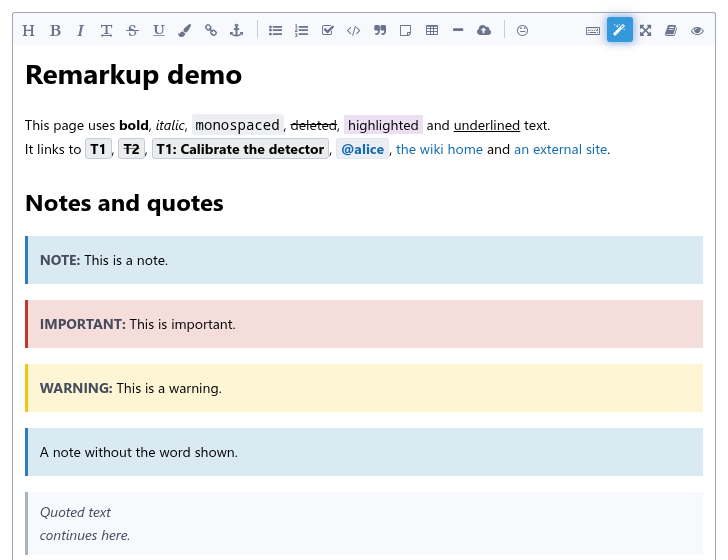
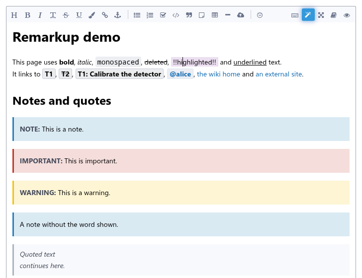
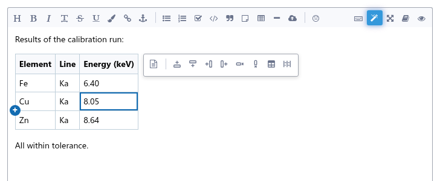
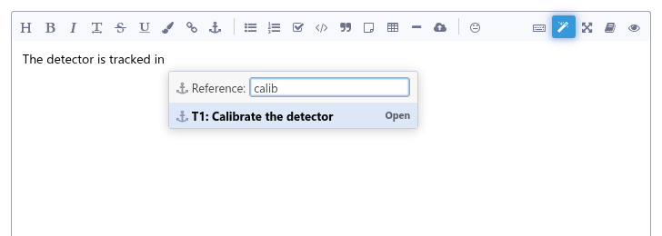
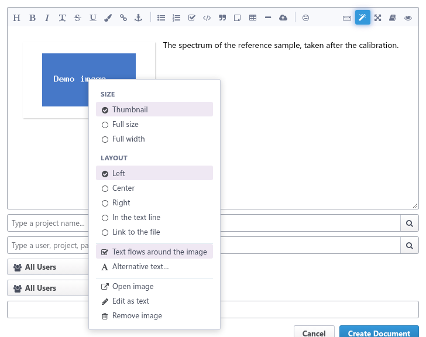
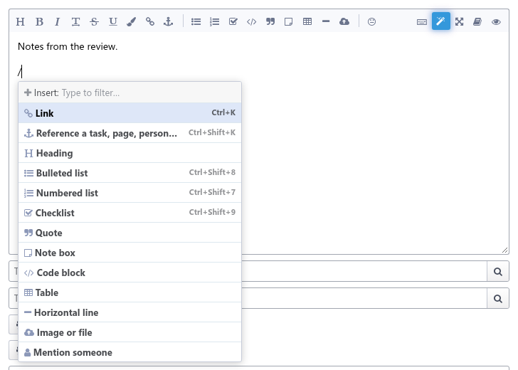
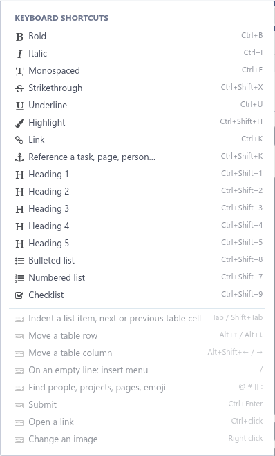
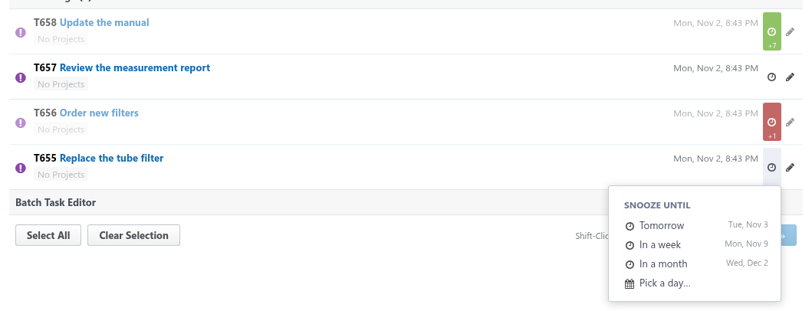

# Phlair

Phlair is a collection of tools for [Phorge](https://we.phorge.it/):

- **[Phizziwig](#phizziwig)**, a live-preview editor for remarkup fields (wiki pages, task descriptions, comments): the
  text looks like the preview while you edit it.
- **[Phuture](#phuture)** snoozes tasks, revisions and any other item of Phorge's lists until a day of your choice.

They are installed in Phorge as a library, where every user turns each tool on or off ([Install](#install)), and come
as a browser extension and a userscript for development.

## Phizziwig

Phizziwig shows every block of the text as Phorge renders it, and only what the cursor is on shows its remarkup
source: a link, a bold word, a list item's checkbox.



### Rendering

- **Exact rendering.** Blocks are rendered by the server through the endpoint the page's preview uses, so links to tasks,
  diffs, wiki pages, users and embedded files look exactly like in the preview. Many blocks are rendered in one request,
  and the result is cached per block. The space between blocks is the page's, measured with its CSS.
- **Everything renders until the cursor is on it.** The text being edited stays rendered, except for what the cursor
  or the selection touches, which shows its remarkup for editing:
  - references, people, projects, links and URLs (`T12`, `@alice`, `#docs`, `{T12}`, `[[ page ]]`, `https://…`) show as
    Phorge renders them; a click on one puts the cursor at its end, `Ctrl`+click opens it;
  - bold, italic, monospaced, struck through, highlighted and underlined text hides its markers;
  - headers and quotes hide their markers, list items show their bullet, number or checkbox (which can be clicked).
    These show when the cursor is in or before them; `Home` goes to the start of the text first.
- **Blocks being edited** keep the size and place of their rendered version, so nothing moves. In a list, only the item
  being edited is source at all; the other items stay rendered, numbered and indented as in the whole list. Click
  rendered text to edit it, `Shift+↑/↓` select line by line, also into rendered blocks.
- **Selecting with the mouse** across rendered blocks (or list items, tables) selects them as a whole, as the selection
  shows while dragging; within the text being edited it selects exactly.
- **Blank lines:** the first blank line between two blocks is the space between them on the page; more blank lines
  are lines like any other while editing (Phorge ignores them).

  

- **The text stays remarkup.** There is no conversion to or from HTML: the stored text is exactly what you type. The
  original textarea stays in the form, hidden, and is kept in sync, so saving, drafts, Phorge's toolbar buttons and
  "Quote" keep working.
- **Any theme:** the editor takes its colors from the page, so it follows Phorge's styles and tools
  like Dark Reader.
- **When the server can not render** a block, the block shows its source, a note says so, and rendering is retried.

### Tables

- **Tables are tables:** they look like Phorge's tables and are edited cell by cell; the cell being edited shows its
  remarkup. Typing in a cell changes only that cell in the text; changing rows or columns aligns the table, with columns
  at most 30 characters wide (a longer cell sticks out instead of widening its column).
- **Table bar:** while the cursor is in a table, a bar next to it (above it when there is no room beside it) inserts and
  deletes rows and columns and toggles the header row. **`+` handles** appear on the left and top borders of the table
  when the mouse is near them and insert a row or column there.
- **Keys:** `Tab`/`Shift+Tab` move between cells (and add a row at the end), `Enter` adds a row (on an empty last row it
  leaves the table), arrow keys move between cells and out of the table, `Alt+↑/↓` move rows, `Alt+Shift+←/→` move
  columns, `Ctrl+Z` undoes, and typing `[[` in a cell adds the closing `]]`. Formatting buttons and the link bubble work
  in cells.
- **New tables** from the table button: pick the size in a grid, and the table opens for editing with its first header
  cell selected.
- **As text:** the first button of the table bar switches to editing tables as aligned text (with `Tab` between cells)
  and back; the choice is remembered. A table the text cursor is in (e.g. a new one being typed) shows its source.



### Links and references

- **Link button and `Ctrl+K`** search wiki pages, tasks (by title) and people, or take a URL; with text selected, it
  becomes the link's text. On an existing link they change it.
- **`Ctrl+Shift+K`** (anchor button) references a task, wiki page, project, person or other object, found by its title,
  e.g. `T12`. On a reference, it opens with the reference filled in, showing what it refers to, and changes it.
- With the cursor in a link, a **bubble** offers to open, change or remove it. A URL pasted over selected text links it.
- **Phorge's autocomplete menu** for `@user`, `#project`, `[[ wiki page`, `:emoji` and `((short URL`, with the
  same rules and keys (a port of its `PHUIXAutocomplete`).



### Images and files

- **Upload** by pasting or dropping files.
- **Images** stay visible while their `{F123}` is edited: above the text if the block starts with the image, as on the
  page, and floating beside it if the image floats.
- **Image menu:** right-clicking an image (a long press on touch screens) opens a menu for its size, layout, text flow
  and alternative text.



### Writing

- **Insert menu:** `/` on an empty line lists what can be inserted (heading, lists, table, note, code, image, mention, …);
  type to filter, arrow keys and `Enter` insert.

  

- **Toolbar** with more buttons than Phorge's, so nobody needs to know the syntax: heading (click again for smaller
  ones), strikethrough, underline, highlight, checklist, note box (click again for important and warning) and horizontal
  line. It stays at the top of the window while you scroll through a long text. Phorge's own bold, italic,
  monospaced, list, code and quote buttons work like the editor's: a second click undoes the first, and list items get
  no indentation.
- **Keyboard shortcuts:** `Ctrl+B`/`I`/`U`/`E` (bold, italic, underline, monospaced), `Ctrl+Shift+X`/`H`
  (strikethrough, highlight), `Ctrl+Shift+1`–`5` (heading levels), `Ctrl+Shift+7`/`8`/`9` (numbered, bulleted,
  checklist), `Ctrl+K` (link). They are named in the tooltips, also of Phorge's own buttons; `F1`, `Ctrl+/` (where
  `/` needs no Shift) or the keyboard button shows them all. `Ctrl+F` is the browser's find, which also finds text in the
  rendered blocks.
- **Wrapping:** typing `*`, `` ` ``, `{` or `[` over selected text puts the text in bold markers, backticks, braces or
  brackets.
- **Lists** switch kinds: the bulleted, numbered and checklist buttons and shortcuts turn the items of the list level the
  cursor is in (up to a blank line, or the selected lines) into that kind, and back into text if they already are. List
  items are indented by two spaces, like Phorge's buttons write them (` -`, ` #`, ` - [ ]`): `# item` at the
  start of a line is a header. A list starting at the start of the line moves in as a whole.
- **Lists and quotes** continue on `Enter`; `Enter` on an empty item ends them. `Tab`/`Shift+Tab` indent list items.
  `Home` (Pos1) in a list item goes to the start of its text, after the marker and checkbox; pressed again, to the
  start of the line. `↑`/`↓` land in the text of list items too, not before their markers.
- **Checklists** can be checked and unchecked by clicking their boxes in the rendered text.
- **Markdown habits:** `*italic*` becomes `//italic//` as it is typed (except in code, monospaced text and URLs; undo
  brings back the `*`). Markdown links `[text](https://…)` work as they are, Phorge renders them.



### Pasting

- **Formatted text** from web pages, e-mails, Word, LibreOffice, Google Docs and Confluence keeps headings, lists,
  tables, links and formatting as remarkup; cells copied from a spreadsheet become a table.
- **Images of this Phorge** in pasted text (copied from a task or wiki page) are not uploaded again: they become
  references to the same files (`{F12}`), with the size and layout they had.
- **Images in pasted text** (e-mails, web pages such as Wikipedia articles) are uploaded and embedded where they were.
  Installed in Phorge, the server downloads images of other sites (within `security.outbound-blacklist`). The
  userscript can fetch them from any site (Tampermonkey asks once to allow that); the extension from sites that allow it
  (CORS), such as Wikipedia. Images that can not be read (e.g. of a web mail behind its login, or attachments
  of a desktop mail program) become a link or their alternative text.
- **Markdown text** becomes remarkup (headings, emphasis, code blocks, images, tables). Headings only get the leading
  `=`.
- `Ctrl+Shift+V` pastes plain text, and code blocks always get the plain text; undo right after a converted paste brings
  back the plain text.

### Around the editor

- **Out of the way:** the wand button in the remarkup toolbar switches between the editor and the plain textarea, and the
  choice is remembered per browser. Phorge's preview below the form is hidden while the editor shows the same.
- **In dialogs** (editing a task or comment) the editor keeps the height of the text field and scrolls inside, like
  it; everywhere else it grows with the text.
- **Phones and tablets** get all toolbar buttons (Phorge hides most of them there); the toolbar wraps.
- The wand button's tooltip shows the version of the running build (and the build time of a development build).

### Limitations

- Hovercards and the lightbox do not work inside the editor, because the rendered HTML comes without Javelin metadata.
  `Ctrl`+click opens links and images.

## Phuture

Phuture puts a clock next to the actions of every item of Phorge's lists: dashboards, searches, workboards, project
and people lists.

- **Snooze** an item until tomorrow, next Monday, in a week, in a month or a picked day. It is hidden on every list
  until that day begins in your time zone, also on a page that stays open over midnight.
- **The clock in the main menu** counts the snoozed items of the page and shows them again (_Show snoozed items_):
  dimmed, with the days until they wake up on their clock (red tomorrow, blue in two weeks or later). Their clock menu
  says until when they sleep and wakes them up now.
- **Kept in the browser:** snoozes belong to the browser they were made in. _Export snoozes_ and _Import snoozes…_ in
  the main menu's clock take them to another browser. The snoozes of the old "JCB Phabricator Snooze" plugin are
  taken over on the first visit, and its exports can be imported.



## Install

**In Phorge** (for everyone, with a setting per user and tool): see [docs/PHORGE.md](docs/PHORGE.md).
Administrators set the defaults in _Global Default Settings → Phlair_, users choose in _Settings → Phlair_.
Both are off by default.

For development, and for instances without the library, the tools also come as a browser extension and a userscript.
They run on the Phorge instances given when they are built:

```bash
npm ci && PHLAIR_HOSTS="https://phorge.example.com/*" npm run build
```

Releases, signing and the store listings: [docs/PACKAGING.md](docs/PACKAGING.md).

- **Firefox:** `about:debugging` → This Firefox → Load Temporary Add-on → `dist/extension/manifest.json`. A permanent
  install needs the extension signed by Mozilla (unlisted).
- **Chrome:** `chrome://extensions` → Developer mode → Load unpacked → `dist/extension`.
- The extension's **options** choose the tools: both are on until turned off there.
- **Userscript** (Violentmonkey, Tampermonkey): install `dist/phlair.user.js`, which runs all tools; add other
  instances in the script's settings. It asks for `GM.xmlHttpRequest` with `@connect *` to fetch the images of pasted
  text from other sites, which Phorge's CSP keeps from the page.

On an instance with the library installed, the tools it starts for the user take precedence: turn a tool off in
_Settings → Phlair_ to try the extension's or userscript's build of it.

## Development

A local Phorge with demo content runs in Docker:

```bash
cd dev/phorge && docker compose up -d
```

It is at http://phorge.localhost:8098/. Log in with the link of `docker compose exec phorge bin/auth recover admin`. The built files are served at `/rme-dev/`, so the editor can
be tried in any page by adding `<script src="/rme-dev/phlair.user.js">`.

| Command                                    | Does                                                                  |
| ------------------------------------------ | --------------------------------------------------------------------- |
| `npm run build`                            | Release build of the library, and for `PHLAIR_HOSTS` the extension.   |
| `npm run build:dev` / `npm run watch`      | Build that also runs on the local instance (needed by the E2E tests). |
| `npm test`                                 | Unit tests (Vitest).                                                  |
| `npm run e2e`                              | Dev build, Playwright tests in Firefox and Chromium, extension test.  |
| `npm run lint:extension`                   | Mozilla's extension linter (`web-ext lint`).                          |
| `npm run screenshots`                      | Takes the screenshots of this README again (local Phorge).            |
| `npm run check`                            | Formatting, types and unit tests.                                     |
| `node scripts/generate-block-fixtures.mjs` | Regenerates the block splitting fixtures with the PHP engine.         |

Keep the feature lists and the screenshots current with every change of a feature: `npm run screenshots` takes them
again from the local instance, with `scripts/screenshots.spec.ts`.

### How it works

`src/main.ts` starts the tools, each once per page: the one installed in Phorge first, else the extension's or the
userscript's (`data-phizziwig` / `data-phuture` on the root element say which runs). Installed in Phorge, the library's
main menu extension starts it as the Javelin behavior `phlair` with the tools the user has on; the extension reads its
options (`src/tools.ts`, `src/options.ts`). `src/dropdown.ts` (Phorge's dropdown menus) and `src/storage.ts` are
shared.

**Phizziwig** (`src/phizziwig/`):

- `blocks.ts` splits the text into top-level blocks exactly like `PhutilRemarkupEngine` (a port of the block rules).
  `test/blocks.test.ts` checks it against the PHP engine on ~3000 texts.
- `renderer.ts` renders blocks in batches: the texts are joined with a separator paragraph and the HTML is split at
  the separators.
  Every block but the last one of the text is followed by a separator, because Phorge renders some blocks
  differently at the end of a text.
- `editor/` holds the CodeMirror 6 extensions:
  - `livePreview.ts`: rendered blocks, the items of lists being edited (with `list.ts`, a port of Phorge's list
    structure), mouse selection, checkboxes; `gaps.ts`: the space between blocks, measured with the page's CSS;
    `sourceStyle.ts`: the source styling of edited blocks;
  - `tableEditor.ts`: tables edited as tables; `commands.ts`: keyboard commands and the table buttons;
    `tablePicker.ts`: the size grid for new tables;
  - `formatting.ts`, `actions.ts`: formatting commands and buttons, the shortcuts; `slashMenu.ts`: the insert menu;
  - `links.ts`, `picker.ts`: links and the search for pages and tasks; `autocomplete.ts`: Phorge's autocomplete;
  - `popup.ts`: Phorge's autocomplete popup, for the menus above;
  - `inlinePreview.ts`: the text being edited rendered, except for what the cursor is on;
  - `upload.ts`, `pasting.ts` (with `paste.ts`), `imageMenu.ts`, `markdown.ts`; `host.ts`: the textarea.
- `attach.ts` puts the editor in place of the textarea, keeps both in sync and takes fonts, sizes and colors from
  the page. `phorge.ts` holds everything that talks to the server or knows its page structure.

**Phuture** (`src/phuture/`): `days.ts` counts in days (`YYYY-MM-DD` of the browser's time zone, compared as text, so
no time zone or clock change moves a snooze), `snoozes.ts` keeps them (and takes over the old plugin's), `index.ts`
adds the buttons and menus.

`phorge/` is the library installed in Phorge (PHP): a setting per tool (`PhlairToolSetting`), the loader and
`phizziwig.download`, see [docs/PHORGE.md](docs/PHORGE.md). Its script is the same as the extension's, built for
`__TARGET__` `phorge`.
