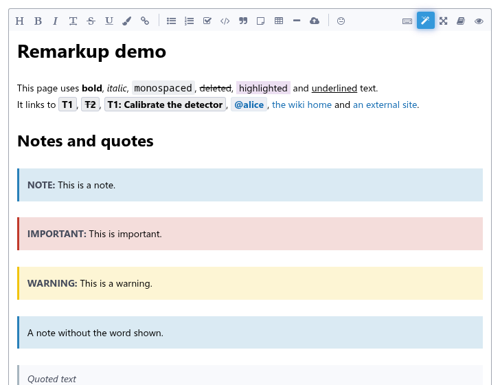

# Phlair

Phlair is a collection of tools for [Phorge](https://we.phorge.it/):

- **[Phizziwig](#phizziwig)**, a live-preview editor for remarkup fields (wiki pages, task descriptions, comments): the
  text looks like the preview while you edit it.
- **[Phuture](#phuture)** snoozes tasks, revisions and any other item of Phorge's lists until a day of your choice.
- **[OneDriphe](#onedriphe)**, a small helper for Windows and Linux, opens SharePoint links from Phorge in Explorer or
  the file manager.

They are installed in Phorge as a library, where every user turns each tool on or off ([Install](#install)), and come
as a browser extension and a userscript for development.



## Phizziwig

Phizziwig shows the text looking like Phorge renders it, and only what the cursor is on shows its remarkup source: a
link, a bold word, a list item's checkbox. Like Obsidian's live preview, the text is always the text being edited, so
nothing moves when the cursor moves. The stored text is exactly what you type: there is no conversion to or from HTML.

- **Rendered as on the page:** formatting, references, mentions, images, code blocks and quotes look like Phorge's
  rendering, with the page's own styles and themes.
- **Tables** are edited as tables, cell by cell, with a bar and keys for rows and columns.
- **Links and references** by title (`Ctrl+K`), Phorge's autocomplete, and an insert menu (`/`) for everything from
  headings to image macros.
- **Pasting** keeps the formatting of web pages, e-mails, Word and Markdown, uploads their images, and turns
  SharePoint links and paths into named links.
- **Images and files** upload by pasting or dropping, in chunks for large files; a menu sets an image's size and layout.
- **Around the editor:** a toolbar that needs no syntax knowledge, shortcuts (`F1`), find and replace, checkboxes that
  can be clicked in rendered text, phones and tablets.

All features: [docs/PHIZZIWIG.md](docs/PHIZZIWIG.md).

## Phuture

Phuture puts a clock next to the actions of every item of Phorge's lists (dashboards, searches, workboards, …). Snooze
an item until tomorrow, next Monday or a picked day, and it is hidden on every list until that day. The clock in the
main menu shows the snoozed items again. Snoozes are kept in the browser.

All features: [docs/PHUTURE.md](docs/PHUTURE.md).

## OneDriphe

In the menu of a SharePoint link, OneDriphe adds _In Explorer_ (on Linux: _In the file manager_): it opens the folder
where the link's library is synced, with the file selected. It is an option of Phizziwig, off by default, and needs
the helper on the user's computer, whose installer the setting offers (no administrator rights needed). Details,
rollout and security: [phorge/onedriphe/README.md](phorge/onedriphe/README.md).

## Install

**In Phorge** (for everyone, with a setting per user and tool): see [docs/PHORGE.md](docs/PHORGE.md). Every tool is
off until someone turns it on: users in _Settings → Phlair_, the administrator for everyone in _Global Default
Settings → Phlair_.

**Browser extension and userscript**, for development and for trying a build before it is installed. They run on the
Phorge instances given when they are built:

```bash
npm ci && PHLAIR_HOSTS="https://phorge.example.com/*" npm run build
```

- **Firefox** (140 or newer): `about:debugging` → This Firefox → Load Temporary Add-on → `dist/extension/manifest.json`.
  A permanent install needs the extension signed by Mozilla (unlisted).
- **Chrome** (120 or newer): `chrome://extensions` → Developer mode → Load unpacked → `dist/extension`.
- The extension's **options** choose the tools: both are on until turned off there.
- **Userscript** (Violentmonkey, Tampermonkey): install `dist/phlair.user.js`, which runs all tools. It asks for
  `GM.xmlHttpRequest` with `@connect *` to fetch the images of pasted text from other sites, which Phorge's CSP keeps
  from the page.

Where the library is installed, the tools it starts for the user take precedence: turn a tool off in _Settings →
Phlair_ to try the extension's or userscript's build of it. Releases, signing and store listings:
[docs/PACKAGING.md](docs/PACKAGING.md).

## Development

```bash
npm ci
cd dev/phorge && docker compose up -d && cd ../..   # a local Phorge at http://phorge.localhost:8098/
npm run check                                       # formatting, types and unit tests
npm run e2e                                         # end-to-end tests against the local Phorge
```

Commands, CI and how the code works: [docs/DEVELOPMENT.md](docs/DEVELOPMENT.md).

## License

MIT (`LICENSE`), Copyright (c) 2026 J&C Bachmann GmbH. Parts are ported from Phabricator (Apache License 2.0); see
[docs/PACKAGING.md](docs/PACKAGING.md#licenses).
