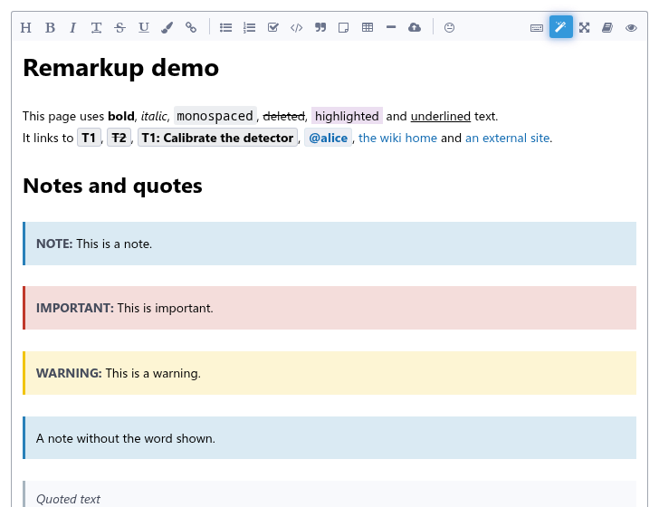
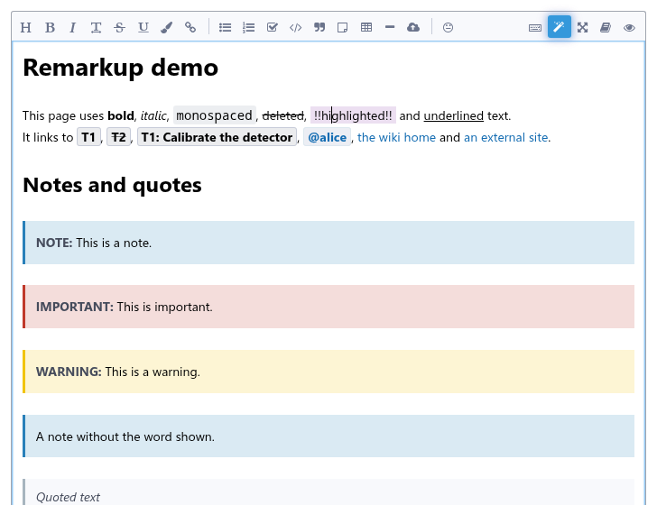
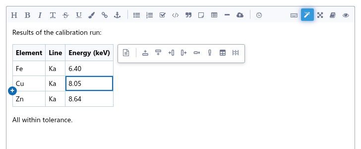
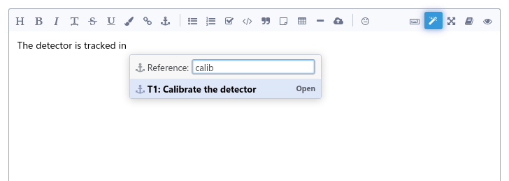
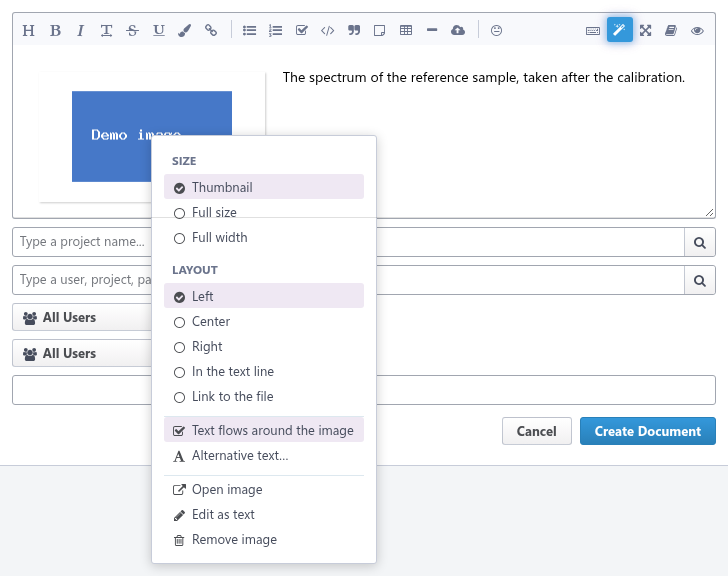
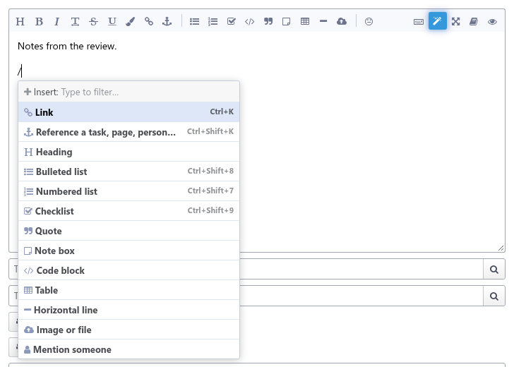
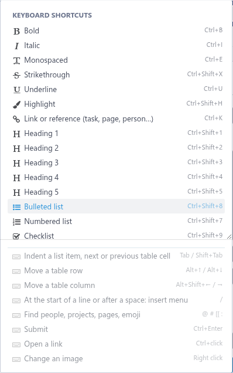

# Phizziwig

Phizziwig shows the text looking like Phorge renders it, and only what the cursor is on shows its remarkup source: a
link, a bold word, a list item's checkbox. Like Obsidian's live preview, the text is always the text being edited, so
nothing moves when the cursor moves.



## Rendering

- **Text is always text.** Paragraphs, headers, lists, quotes, notes and rules show their source, styled like
  Phorge's rendering with the page's own CSS (sizes, fonts and colors read from the page), with their markup hidden:
  - references, people, projects, links and URLs (`T12`, `@alice`, `#docs`, `{T12}`, `[[ page ]]`, `https://…`) show as
    Phorge renders them, each rendered by the server; a click on one puts the cursor at its end, `Ctrl`+click opens it;
  - bold, italic, monospaced, struck through, highlighted and underlined text hides its markers;
  - headers hide their markers unless the cursor is on their line; quotes (also the `>>!` of replies), the word of
    `(NOTE)` notes and rules hide theirs; list items show their bullet, number or checkbox (a click on a bullet or
    number edits it, on a checkbox checks it, left of them goes to the start of the line), where the page draws it
    and as far apart as the page's items, also in nested lists, checklists and quotes (items in a checked item are
    grey, as on the page);
  - in quotes, headers, lists, notes and rules look like themselves too, as Phorge renders them there; code blocks
    and tables in quotes show rendered like elsewhere (tables edited cell by cell), with Phorge's space between
    blocks on consecutive lines;
  - icons, keys and navigation paths (`{icon camera color=red}`, `{key Ctrl K}`, `{nav Home > Settings}`) show as
    Phorge draws them;
  - images, image macros and memes show as rendered, their `{F123}` or `{meme, …}` hidden;
  - anchors (`{anchor #name}`), which Phorge does not show, show as their name with a `#` icon.

  Only what the cursor or the selection touches shows its remarkup; markers before text (a header's `= `, a list
  item's `- [ ] `) show when the cursor is in or before them, and `Home` goes to the start of the text first. A click,
  `Home` or `End` next to formatted text puts the cursor outside of its markers, as the text looks: after `**bold**`,
  not before its closing `**`. A click between two blocks goes to the nearer line. The
  text does not have to match Phorge's rendering to the pixel, but nothing moves when the cursor comes or goes.

- **Rendered blocks.** Code blocks, literal blocks and other blocks show as the server renders them (through the
  endpoint the page's preview uses, many blocks in one request, cached per block), and show their source while the
  cursor is in them, in the same place: a code block keeps room for its "```" lines. Blocks on consecutive lines are
  as far apart as on the page, measured with its CSS. Tables are edited as tables, see below.
- **Moving and selecting** works like in a text field: `↑`/`↓` and `Shift+↑/↓` go row by row (also through wrapped lines)
  and keep the column, also through rendered blocks, and the mouse selects exactly the text it goes over (tables as a whole). While the mouse selects, rendered
  blocks stay rendered, with the selected text highlighted.
- **Blank lines** are as high as a line of text, also between blocks, so nothing moves when the cursor comes near
  them (on the page, the space between blocks is Phorge's, and more blank lines than one are ignored).

  

- **The text stays remarkup.** There is no conversion to or from HTML: the stored text is exactly what you type. The
  original textarea stays in the form, hidden, and is kept in sync, so saving, drafts, Phorge's toolbar buttons and
  "Quote" keep working.
- **Any theme:** the editor takes its colors from the page, so it follows Phorge's styles and tools
  like Dark Reader.
- **When the server can not render** a block, the block shows its source (and a text block its images do not show), a
  note says so, and rendering is retried.

## Tables

- **Tables are tables:** they look like Phorge's tables and are edited cell by cell; the cell being edited has the live
  preview of the text, so only what the cursor is on shows its remarkup. Typing in a cell changes only that cell in the text; changing rows or columns aligns the table, with columns
  at most 30 characters wide (a longer cell sticks out instead of widening its column).
- **Table bar:** while the cursor is in a table, a bar next to it (above it when there is no room beside it) inserts and
  deletes rows and columns and toggles the header row. **`+` handles** appear on the left and top borders of the table
  when the mouse is near them and insert a row or column there.
- **Keys:** `Tab`/`Shift+Tab` move between cells (and add a row at the end), `Enter` adds a row (on an empty last row it
  leaves the table), arrow keys move between cells and out of the table (`↑` from a table at the start of the text
  makes a new line above it, as `↓` at the end does below it), `Alt+↑/↓` move rows, `Alt+Shift+←/→` move
  columns, `Ctrl+Z` undoes, and typing `[[` in a cell adds the closing `]]`. A cell is edited like a line of the text:
  formatting buttons and shortcuts, `Ctrl+K`, the link bubble, a URL pasted over selected text, pasted SharePoint
  links and local paths of SharePoint libraries (they become links, see Pasting; `Ctrl+Z` gives them back as
  pasted), uploads (the upload button, pasting and dropping files), Phorge's autocomplete and the insert menu (with
  what fits in a cell) work in cells.
- **New tables** from the table button: pick the size in a grid, and the table opens for editing with its first header
  cell selected. A pasted table (also cells of a spreadsheet or a table of a web page) opens for editing in the cell
  the paste ends in; in a quote, and pasted with `Ctrl+Shift+V`, it stays text. Pasted text goes into a cell on one
  line, its `|` as `¦` (which does not end the cell), except in links (`[[ url | name ]]`).
- **As text:** the first button of the table bar switches to editing tables as aligned text (with `Tab` between cells)
  and back; the choice is remembered. A table the text cursor is in (e.g. a new one being typed) shows its source.
  `Enter` before the first `|` of a table makes a new line above it.



## Links and references

- **Link button and `Ctrl+K`** (also `Ctrl+Shift+K`) open a dialog with the **text** and the **target** of a link or
  reference. The target is searched for, or a URL is taken: wiki pages and tasks with the words in their title, then those
  with them in their text; each open ones before closed (deleted or moved) ones, and wiki pages before tasks; then
  people, projects, repositories and other objects. Selected text is the link's text (and stays highlighted while
  the dialog is open); with the cursor on a link, a reference or a card (`T12`, `@alice`, `{T12}`) they change it.
  Without a text, the target alone is written: a task picked anew as its card (`{T12}`, which shows its title and
  status), others as their reference (`@alice`, `D3`, a URL), and the reference being changed as it was written;
  without a target, the text alone; without either, nothing. `Tab` goes between the fields, `Enter` applies.
- With the cursor in a link, a **bubble** offers to open, change or remove it. A URL pasted over selected text links it.
- **Phorge's autocomplete menu** for `@user`, `#project`, `[[ wiki page`, `:emoji` and `((short URL`, with the
  same rules and keys (a port of its `PHUIXAutocomplete`).



## Images and files

- **Upload** by pasting or dropping files. Files over 4 MB go in chunks, like Phorge's own uploads, so the server's
  request size limit does not stop them. A line below the text shows the uploads running (with their progress) and the
  ones that failed. A form submitted meanwhile is sent once the uploads are done (_Don't send_ cancels that), not with
  their placeholders in the text.
- **Images** stay visible while their `{F123}` is edited: above the text if the block starts with the image, as on the
  page, and floating beside it if the image floats.
- **Image menu:** right-clicking an image, its "⋯" button (shown on the image under the mouse), a long press on touch
  screens, or `Shift+F10` (or the menu key) with the cursor on its `{F123}` opens a menu for its size, layout, text
  flow and alternative text.



## Writing

- **Insert menu:** `/` at the start of a line or after a space lists what can be inserted (headings, also by level as `/h2`, lists, table, note, important and warning boxes, code,
  image, image macro (found by name, with its picture, in a list to scroll through), meme, task or revision card,
  anchor, literal text, icon (found by name; a color word like `red` colors it, `spin` makes it spin), keyboard keys,
  navigation path, ASCII art (`cowsay`, `figlet`), mention, emoji, …), grouped under headings (headings, lists,
  blocks, links, text, images, ASCII art); in a table cell, what fits in a cell; type to filter, arrow keys and `Enter` insert. While nothing matches, the menu hides until `Backspace` fixes the typo; a space, `Escape` or deleting the `/` ends it. A `/` in a word or path (`and/or`, `/home`) is just text.

  

- **Toolbar** with more buttons than Phorge's, so nobody needs to know the syntax: heading (click again for smaller
  ones), strikethrough, underline, highlight, checklist, note box (click again for important and warning) and horizontal
  line. It stays at the top of the window while you scroll through a long text. Phorge's own bold, italic,
  monospaced, list, code and quote buttons work like the editor's: a second click undoes the first, and list items get
  no indentation.
- **Keyboard shortcuts:** `Ctrl+B`/`I`/`U`/`E` (bold, italic, underline, monospaced), `Ctrl+Shift+X`/`H`
  (strikethrough, highlight), `Ctrl+Shift+1`–`5` (heading levels), `Ctrl+Shift+7`/`8`/`9` (numbered, bulleted,
  checklist), `Ctrl+K` (link). They are named in the tooltips, also of Phorge's own buttons; `F1`, `Ctrl+/` (where
  `/` needs no Shift) or the keyboard button shows them all; the empty editor says so.
- **Find and replace:** `Ctrl+F` in the editor finds in all of the text (the browser's find only sees the part on the
  screen), in a bar below the toolbar; `Enter`/`F3` go to the next match, `Escape` closes it.
- **Menus by keyboard:** the menus (images, shortcuts, Phuture's) take the focus when they open: the arrow keys,
  `Home` and `End` move in them, `Enter` or `Space` chooses, `Escape` and `Tab` close them. The table button's size
  grid goes by the arrow keys too.
- **Wrapping:** typing `*`, `` ` ``, `{` or `[` over selected text puts the text in bold markers, backticks, braces or
  brackets.
- **Lists** switch kinds: the bulleted and numbered buttons and shortcuts turn the items of the list level the cursor is
  in (up to a blank line, or the selected lines) into that kind, and back into text if they already are; their
  checkboxes stay. The checklist button and shortcut give the item the cursor is in (or the selected ones) a checkbox, or
  take it away, whatever kind of list it is in. List
  items are indented by two spaces, like Phorge's buttons write them (` -`, ` #`, ` - [ ]`): `# item` at the
  start of a line is a header. A list starting at the start of the line moves in as a whole.
- **Lists and quotes** continue on `Enter`; `Enter` on an empty item ends them, leaving its line empty (a list in a
  quote ends, the quote goes on). Everything for lists, headers and tables works in quotes too, the buttons change the
  text after the `>`; code blocks in quotes are code (pasted text stays plain). `Enter` in the marker of a list item
  (e.g. at the start of its line) makes an empty line above it, as in Obsidian; at the start of its text (also of the
  first item), an empty item above it, the text keeping its checkbox. `Backspace` at the start of the text of a quote
  line removes its `>`. `Enter` at the start of the text of a quote or header makes room above it.
  `Tab`/`Shift+Tab` indent list items:
  by two spaces, or in a list nested by repeating markers (`- item`, `-- nested`), by one marker.
  `Home` (Pos1) in a list item goes to the start of its text, after the marker and checkbox; pressed again, to the
  start of the line. `↑`/`↓` land in the text of list items too, not before their markers (from before a marker, before
  the next one).
- **Notes and list items have no line breaks** in remarkup: Phorge shows the lines of a note, and the lines continuing a
  list item, as one line, until a blank line. While edited, such lines are marked with a faint `↪` in the margin; a note
  of more lines than one shows on one line, like in Phorge, while the cursor is not in it.
- **Checklists** can be checked and unchecked by clicking their boxes, also items without a bullet (`[ ] item`).
- **Markdown habits:** `*italic*` becomes `//italic//` as it is typed (except in code, monospaced text and URLs; undo
  brings back the `*`). Markdown links `[text](https://…)` work as they are, Phorge renders them.



## Pasting

- **Formatted text** from web pages, e-mails, Word, LibreOffice, Google Docs and Confluence keeps headings, lists,
  tables, links and formatting as remarkup; cells copied from a spreadsheet become a table.
- **Images of this Phorge** in pasted text (copied from a task or wiki page) are not uploaded again: they become
  references to the same files (`{F12}`), with the size and layout they had.
- **Images in pasted text** (e-mails, web pages such as Wikipedia articles) are uploaded and embedded where they were.
  Installed in Phorge, the server downloads images of other sites (within `security.outbound-blacklist`). The
  userscript can fetch them from any site (Tampermonkey asks once to allow that); the extension from sites that allow it
  (CORS), such as Wikipedia; neither fetches images of private networks (intranet names, local domains, private
  addresses), unless Phorge is on one too. Images that can not be read (e.g. of a web mail behind its login, or attachments
  of a desktop mail program) become a link or their alternative text.
- **Markdown text** becomes remarkup (headings, emphasis, code blocks, images, tables, reference links), as a Markdown
  parser reads it (`@lezer/markdown`, with GitHub's extensions). Headings only get the leading `=`. Remarkup copied
  from Phorge stays as it is (code blocks with options like `lang=`, replies, file embeds and named links
  `[[ … | … ]]` tell it apart); `_` and `*` in project tags and mentions (`#a_b_c`) are no emphasis.
- **SharePoint and OneDrive links to files and folders** pasted alone become a link with a name (`[[ https://… | … ]]`), so the long URL
  does not show: the file's name where the URL has it (copied from the address bar), else its kind and site ("Excel
  workbook in Projects"), selected to be typed over. Sharing links ("Copy link") only name the kind of file and the site.
  Office's links for its apps (`ms-word:ofe|u|https://…`) give their URL.
- **Local paths of SharePoint libraries** pasted alone become a link to the folder or file on SharePoint, which everyone
  can open, with the menu of SharePoint links (and _In Explorer_): paths as Explorer copies them
  (`C:\Users\me\OneDrive - Contoso\Documents\Plans`), also of WSL, macOS and Linux, and `file:///…`. The
  administrator lists the libraries in _Config → Phlair_ (`phlair.sharepoint-folders`): each library's URL with the
  names its folder has on users' computers (a synced library, a shortcut in OneDrive, an rclone mount), e.g.
  `{"https://contoso.sharepoint.com/sites/Projects/Shared%20Documents": ["Projects - Documents", "OneDrive - Contoso/Documents"]}`.
  A name may include folders above it, for one that is not unique by itself, and names one library only. A name with an
  extension is a file's (`Plan.step`), else a folder's, also with digits only (`2026.11`). Other paths stay as pasted.
  Only with the Phorge library, which passes the list to the pages of users who have Phizziwig on.
- `Ctrl+Shift+V` pastes plain text, and code blocks always get the plain text; undo right after a converted paste brings
  back the plain text.

## Around the editor

- **Out of the way:** the wand button in the remarkup toolbar switches between the editor and the plain textarea, and the
  choice is remembered per browser. Phorge's preview below the form is hidden while the editor shows the same.
- **In dialogs** (editing a task or comment) the editor keeps the height of the text field and scrolls inside, like
  it; everywhere else it grows with the text.
- **Tablets** get all toolbar buttons (Phorge hides most of them there); the toolbar wraps.
- The wand button's tooltip shows the version of the running build (and the build time of a development build).
- **Feedback:** the speech bubble button opens a new task for feedback on the editor in a new tab, with questions and
  the details that help (version, page, browser); screenshots can be pasted into it. Builds can give these tasks a
  project (`PHLAIR_FEEDBACK_PROJECT`, see [docs/PACKAGING.md](PACKAGING.md)).
- **Pinned comment form** ("Pin Form on Screen"): its text scrolls inside it, so the row of "Add Action..." with the
  submit button (on phones an icon) and the toolbar stay in view; a handle on its top border sets its height (also by
  touch), which is
  remembered per browser.
- **Phones** get one row of essential toolbar buttons; "⋯" has the others. Menus open in the middle of the window
  there, and scroll where they do not fit (elsewhere they open where there is room).
- **Fullscreen:** the editor has the page's background (Phorge's text field is a tint over the page).
- **Actions of a comment** can be removed by their X on phones too (Phorge hides it there).
- **Checkboxes in rendered text** can be clicked: in task descriptions, revision summaries and test plans, wiki pages
  and comments, a click checks or unchecks the box at once, and 5 seconds after the last click the boxes clicked are
  saved, one edit per text (only those boxes change, as the page shows them), if you may edit it. A link followed saves
  them first; when the page is hidden or left otherwise (another tab or app, closing, reloading, where the browser asks
  first), they are saved right away, in a request the browser finishes after the page is gone.
  Quitting the browser at once, or a text over 64 KB, can still lose them: browsers give a closing page no more time.
- **SharePoint and OneDrive links to files and folders in rendered text** keep their text, and show an icon of the
  kind of file and, on hover, what the URL tells about the file (its kind, name, site and folder). Where there is more
  than one way to open one, a click shows them in a menu (Ctrl+click opens the link in a new tab), under two headings
  named as in Explorer: _Open file_ (or _Open folder_) in the browser, or in Word, Excel or PowerPoint
  (`ms-excel:ofe|u|…`; not on Linux, which has no Office); and _Open file location_, where the URL has the file's
  path: its folder in the browser, or in Explorer (below). With one way, the link is a link as any. While an app
  starts, a note under the link says so, and after a few seconds without the app what to do (allow the browser to open
  it, or open the file in the browser instead). Links to other pages of SharePoint (a person, a site's page) are links
  like any other. Phorge
  turns the `:x:` (Excel), `:b:` (PDF), `:v:` (video) and `:o:` (OneNote) of sharing links into emoji, which breaks
  them; the library's remarkup rule prevents that for everyone (see [docs/PHORGE.md](PHORGE.md)), and the editor
  repairs such links where Phorge has no library.
- **SharePoint folders in Explorer or the file manager** (an option, off by default): on Windows and Linux, links to
  folders and files that have their path (copied from the address bar, not "Copy link") can be opened in the file
  manager too (_In Explorer_ or _In the file manager_ in the menu). [OneDriphe](../phorge/onedriphe/README.md), Phlair's
  helper, opens the folder where the OneDrive app syncs it (on Linux: where rclone mounts it, as listed in
  `~/.config/onedriphe/libraries`), or a file's folder with the file selected, and opens the link in the browser where
  the folder is not there. The administrator can limit it to the company's tenant in _Config → Phlair_
  (`phlair.onedriphe-hosts`, e.g. `contoso.sharepoint.com` and `contoso-my.sharepoint.com`), so that links of others'
  tenants open in the browser only. To
  turn it on, follow the steps of _OneDriphe: SharePoint Links_ in Phorge's _Settings → Phlair_:
  download and run the installer (no administrator rights needed), then choose _On_. With the extension, the option is
  on its options page.

## Limitations

- Hovercards and the lightbox do not work inside the editor, because the rendered HTML comes without Javelin metadata.
  `Ctrl`+click opens links and images.
