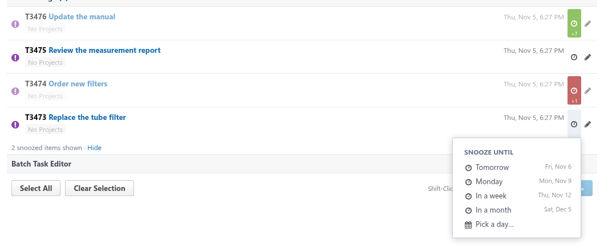

# Phuture

Phuture puts a clock next to the actions of every item of Phorge's lists: dashboards, searches, workboards, project
and people lists, commits (audits). Lists of choices, like "Choose Subtype" when creating a task, have none.

- **Snooze** an item until tomorrow, next Monday, in a week, in a month or a picked day. It is hidden on every list
  until that day begins in your time zone, also on a page that stays open over midnight.
- **Undo:** a note after snoozing (or waking up) an item undoes it.
- **Below a list** with snoozed items, a line says how many are hidden and shows them (or hides them again).
- **The clock in the main menu** counts the hidden snoozed items of the page, lists the snoozes (the 15 next to wake
  up) and shows the snoozed items again (_Show snoozed items_): dimmed, with the days until they wake up on their
  clock (red tomorrow, blue in two weeks or later). Their clock menu says until when they sleep and wakes them up now.
  The choice applies to the site's other open tabs at once.
- **Bulk edits** leave hidden snoozed tasks out: Maniphest's _Select All_ selects only the tasks shown.
- **Kept in the browser:** snoozes belong to the browser they were made in. _Export snoozes_ and _Import snoozes…_ in
  the main menu's clock take them to another browser.

